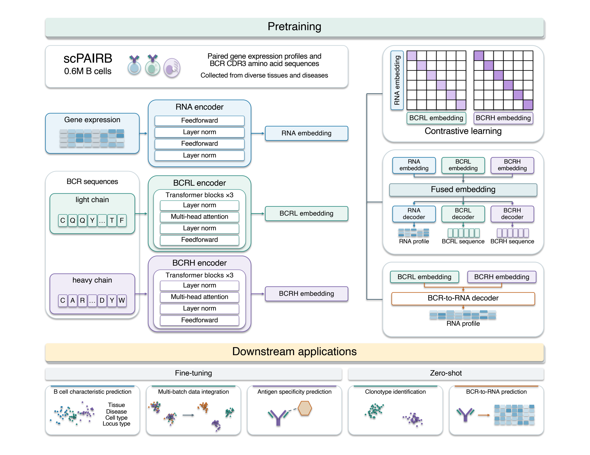

# BCRFoundation

[](https://BCRFoundation.readthedocs.io/en/latest/?badge=latest)
[](https://opensource.org/licenses/MIT)
[](https://www.python.org/downloads/)

**A multimodal foundation model for single-cell immune profiling**

## Overview

BCRFoundation integrates gene expression and BCR sequences (light and heavy chains) from paired single-cell measurements through self-supervised pretraining with masked reconstruction and cross-modal contrastive learning.

[](figure/Figure1.pdf)

*Figure 1. Overview of BCRFoundation. Click the image to view the PDF.*

### Input and Pretraining Architecture

Gene expression profiles are encoded through feed-forward layers, while BCR sequences are tokenized and processed through transformer blocks. The fused representations are learned via three objectives: masked gene expression reconstruction, masked BCR sequence reconstruction, and cross-modal alignment.

### Fine-tuning Tasks

The pretrained model supports three downstream applications:

- **B-cell state classification**: Predict tissue origin, disease state, and cellular phenotype
- **Binding specificity detection**: Identify BCR-antigen interactions
- **Cross-modal prediction**: Infer gene expression from BCR sequences

## Installation

### From GitHub

```bash
git clone https://github.com/haotian-zhuang/BCRFoundation.git
cd BCRFoundation
pip install -e .
```

**Requirements**: Python 3.8+, PyTorch 1.10.0+

## Quick Start

```python
import BCRFoundation as bcrf
import scanpy as sc

# Load your data
adata = sc.read("your_data.h5ad")

# Pretrain the foundation model
model, history = bcrf.pretrain.train(
    adata,
    epochs=500,
    batch_size=2048,
    save_dir='models/'
)

# Fine-tune for classification
results, adata_new = bcrf.finetune.classification.train_classifier(
    adata,
    label_column="cell_type",
    checkpoint_path="models/foundation_model_best.pt",
    num_epochs=50
)
```

## Zero-shot BCR-to-RNA prediction

Use the pretrained BCR encoders, their normalization layers, and the dedicated
BCR2gene decoder without fine-tuning. The input only needs paired CDR3 columns
in `adata.obs`; RNA is optional and is used only when `evaluate=True`.

```python
results, adata_pred = bcrf.finetune.cross_modal_zeroshot.predict_regressor(
    adata,
    checkpoint_path="models/foundation_model_best.pt",
    cdr3l_col="IR_VJ_1_junction_aa",
    cdr3h_col="IR_VDJ_1_junction_aa",
    evaluate=False,
)
predictions = adata_pred.obsm["X_gene_pred_bcr_only_zeroshot"]
gene_names = adata_pred.uns["bcr2gene_zeroshot"]["gene_order"]
```

Prediction columns follow the checkpoint gene order, independently of the input
`adata.var_names`. Input expression and existing splits are preserved. To score
measured RNA, set `evaluate=True` and optionally pass the same
`custom_splits=(train_indices, val_indices, test_indices)` used for fine-tuning.
Only measured genes overlapping the checkpoint are scored, on the pretraining
expression scale. Results are under `results["bcr_only"]`, with `"all"` or
`"train"`, `"val"`, and `"test"` groups. No fitting or checkpoint selection occurs.
Legacy checkpoints without the dedicated BCR2gene decoder are rejected.

## Contact

- **Author**: Haotian Zhuang
- **Email**: haotian.zhuang@duke.edu
- **GitHub**: [https://github.com/haotian-zhuang](https://github.com/haotian-zhuang)
