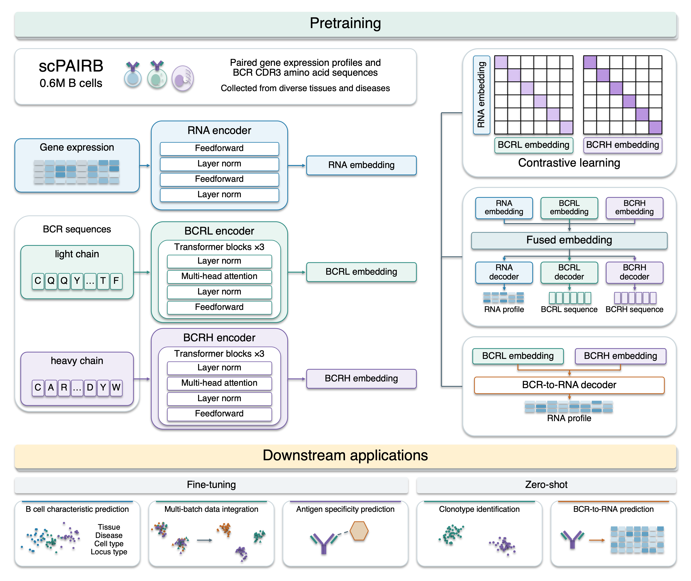

# BCRFoundation Documentation

BCRFoundation is a multimodal foundation model pretrained on scPAIRB, a curated
corpus of over 0.6 million B cells with paired gene expression profiles and BCR
sequences. These tutorials reproduce the settings used for pretraining and the
IBD-Boland B cell characteristics prediction and zero-shot BCR-to-RNA analyses.



Start with [installation](installation.md) and the
[data and checkpoint requirements](data_and_checkpoints.md). Each tutorial
includes its own setup code and explains its inputs and outputs.

## Getting started

```{toctree}
:maxdepth: 1
:caption: Getting started

installation
data_and_checkpoints
```

## Tutorials

```{toctree}
:maxdepth: 1
:caption: Tutorials

tutorials/01_pretraining
tutorials/02_classification
tutorials/03_BCR2RNA
```

## Project and support

- [Source code](https://github.com/haotian-zhuang/BCRFoundation)
- [Report an issue](https://github.com/haotian-zhuang/BCRFoundation/issues)
- Maintainer: Haotian Zhuang ([haotian.zhuang@duke.edu](mailto:haotian.zhuang@duke.edu))

Citation information will be added with the corresponding publication.
